# SNY — Septa Line Inspection

**Multi-camera industrial surface inspection: traditional computer vision and AI anomaly detection, turned into measured defects, readable rules and one GOOD / NG decision per fabric section.**


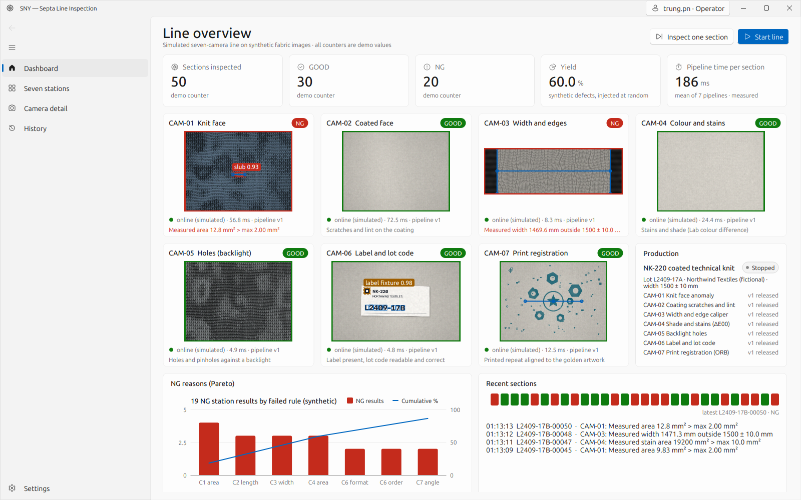

| | |
|---|---|
| **What** | An inspection station for a coated technical knit, seen by seven cameras. Each camera looks for a different failure mode and the line gets one verdict per fabric section. |
| **Why it matters** | Fabric defects are rare, varied and cheap to miss. Unsupervised anomaly detection finds what nobody labelled. Rules expressed in mm and mm² make the decision explainable to operators and adjustable by engineers. |
| **What the system does** | Camera frame → ROI and preprocessing → classical CV and an anomaly model → defects that are classified and measured → rules → GOOD / NG → line output and monitoring. |
| **Result** | Every NG comes with sentences such as *"Measured area 3.83 mm² > max 2.00 mm²"*, the pipeline step that produced it, its measured time and the overlay on the image. |

> **Two layers, kept apart.** The [production context](#production-context) describes the original fabric-inspection system the author built and deployed. Everything else (screenshots, diagrams of the application, demo numbers) comes from a **portfolio implementation** that runs on a **simulated line with procedurally generated fabric**. No production image, model or configuration is published here.

---

## Overview

A technical fabric fails in several unrelated ways at once: yarn defects on the knit face, damage on the coating, width and edge straightness, shade and stains, holes, a wrong or unreadable lot label, and a misregistered print. Each needs different lighting and a different algorithm. The line still needs **one decision per section, one history, and one place where engineers tune and release the logic.**

SNY is that place: a desktop application where every camera runs a versioned inspection pipeline, every rule's outcome is visible, and operators, engineers and administrators each see what their role needs.

## Key Capabilities

| Capability | What it means here |
|---|---|
| **Multi-camera inspection** | Seven stations, each with its own lighting, resolution and mm/px calibration; NG at any station rejects the section. |
| **Unsupervised anomaly detection** | Learned from good fabric only, producing a pixel heatmap and an image score; no defect labels needed. |
| **Traditional machine vision** | Sub-pixel edge caliper, CIEDE2000 colour difference, backlight blob analysis, template matching, ORB + RANSAC registration, a light OCR. |
| **Defect analysis** | Anomaly masks become objects, classified (slub, knot, ladder, scratch, lint…) with a confidence filter. |
| **Measurement and rules** | Area, length, width, edge deviation, ΔE, offset and angle in physical units; min / max / tolerance / count / text rules, region-specific rules, severity, AND / OR. |
| **ROI editor** | Inspect and ignore regions (rectangles, polygons) per camera, tested on a sample before saving. |
| **Visual pipeline editor** | Typed node graph with a palette, validation, per-node previews and timings, and draft → released versions with a parameter diff. |
| **Traceability and roles** | History with filters and CSV export; operator, engineer and administrator permissions; audit log. |

## System Architecture


The inspection core (pipeline graph, vision, AI stages, rules) has no UI dependency and is tested headless. The desktop UI receives throttled updates from worker threads, and results computed with an outdated pipeline or ROI set are dropped. More in [docs/architecture.md](docs/architecture.md).

## Workflow

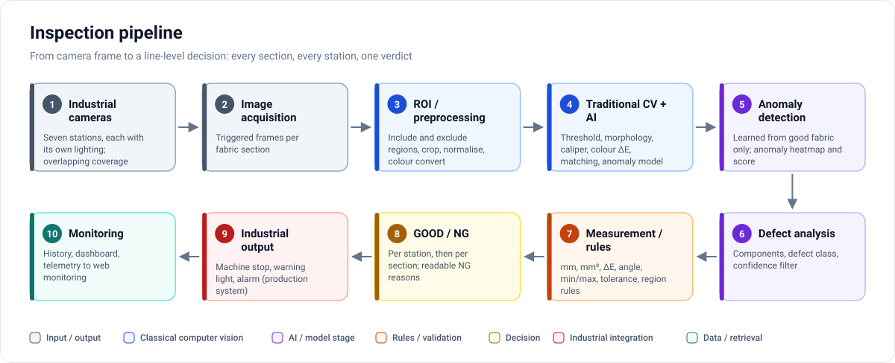

Each station specialises the same pattern. The AI station on the knit face, as configured in the node graph:

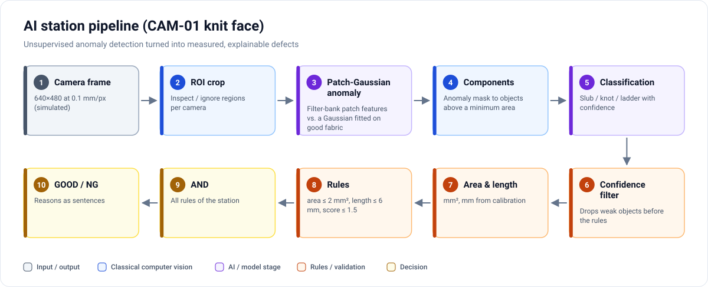

Details of all seven station pipelines and how rules turn into a verdict: [docs/workflow.md](docs/workflow.md).

## Technical Highlights

- **One engine for classical CV and AI.** Anomaly models, detectors, calipers and colour checks are all typed nodes in the same graph, so a station can combine them (CAM-02 runs an anomaly branch and a black-hat thresholding branch in parallel).
- **Anomaly maps → measurable defects.** A heatmap is not a decision. Connected components, classification and a confidence filter turn it into objects with an area in mm² and a length in mm, which the rules then judge.
- **Explainable decisions.** Every rule renders its own sentence with the measured value and the limit, and carries a severity (minor failures become warnings, not rejects).
- **Region-aware inspection.** ROIs exclude splice tape or seam overlaps and add stricter priority zones, so the same defect can be acceptable at the edge and NG in the centre.
- **Replaceable inference.** Segmentation and classification run behind a backend interface. The default is deterministic and weight-free; an ONNX model can be selected instead.
- **Engineering lifecycle.** Pipelines are validated (type mismatches, cycles, unconnected inputs) before release, released versions are immutable, and history records which version produced each result.

Deeper notes on the anomaly model, measurement and rules: [docs/technical_overview.md](docs/technical_overview.md).

## User Interface

| | |
|---|---|
| 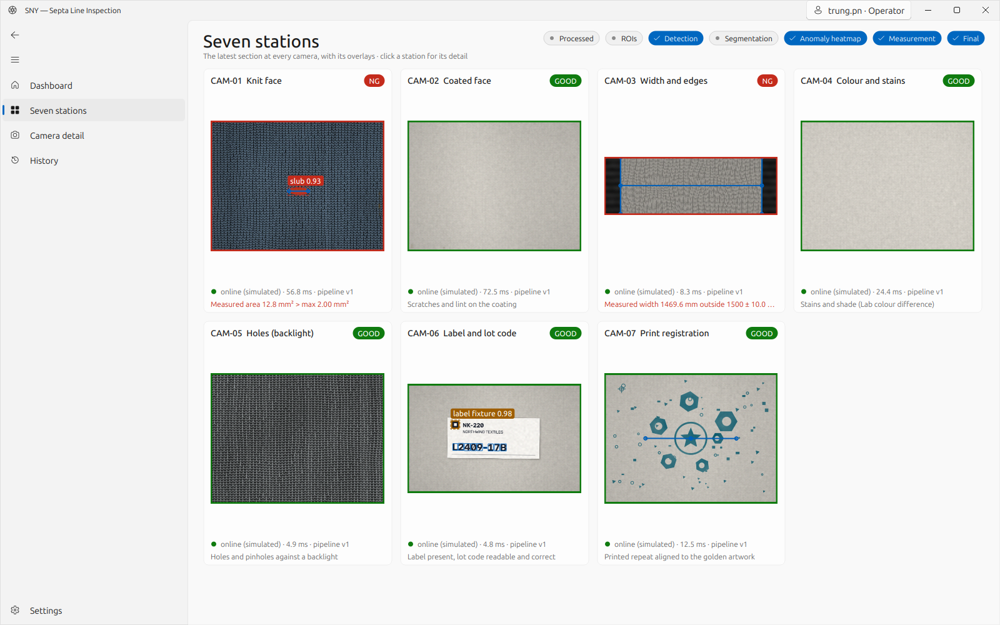 **Seven stations.** What operator `trung.pn` watches: the latest section at every camera with selectable overlay layers. | 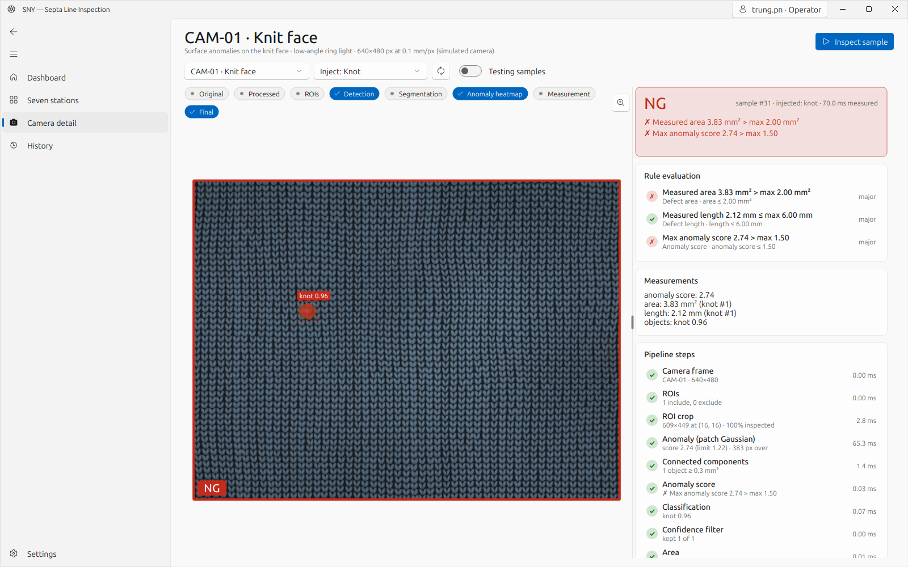 **Camera detail.** Opened by `trung.pn` from a red tile: a knot found by the anomaly heatmap, classified, measured and rejected, with every rule and timed step. |
| 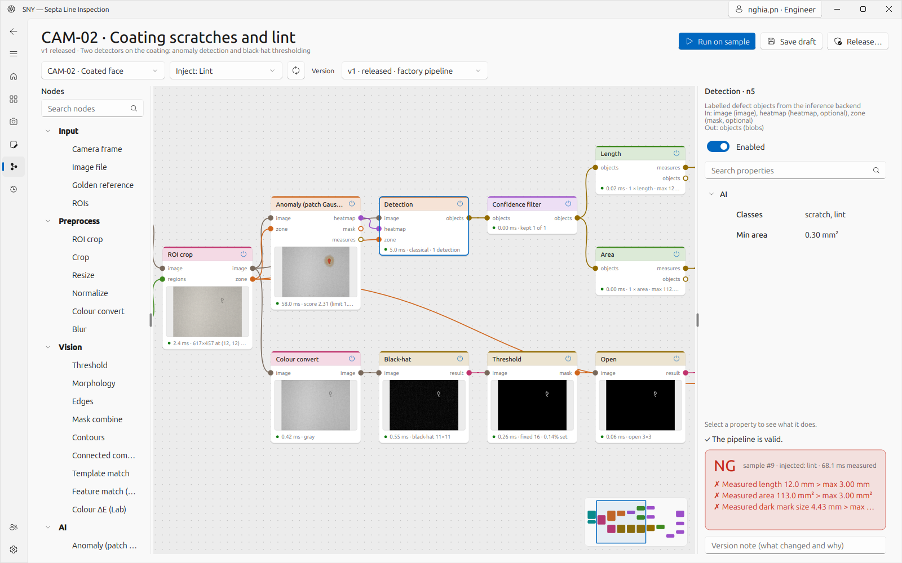 **Pipeline editor.** Anomaly detection and black-hat thresholding in parallel on the coated face, with per-node previews. | 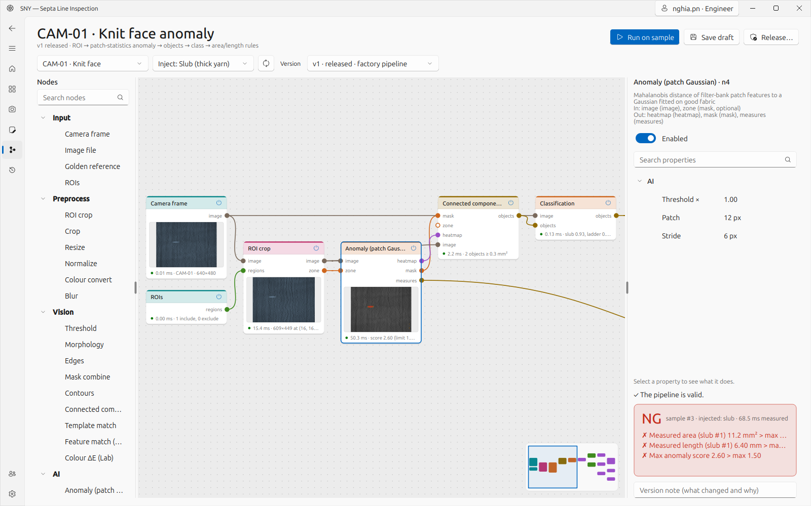 **AI pipeline.** ROI crop → patch-statistics anomaly → components → classification → rules. |
| 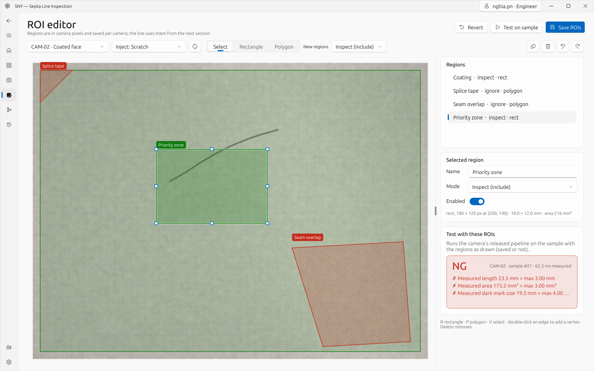 **ROI editor.** Inspect and ignore regions per camera, tested on a sample before saving. | 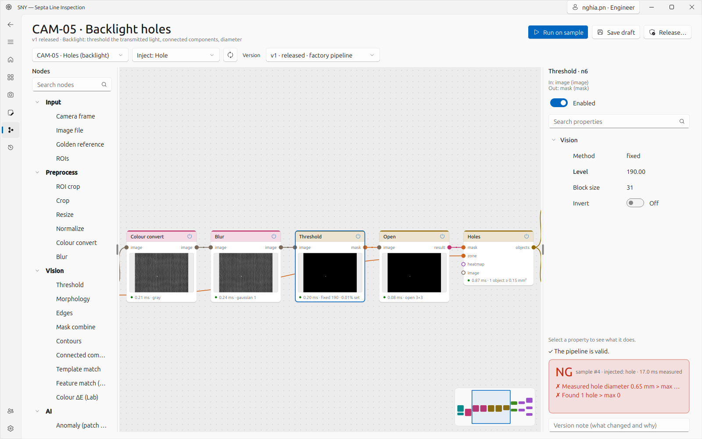 **Traditional CV.** Backlight → threshold → morphology → components → hole diameter and count. |
| 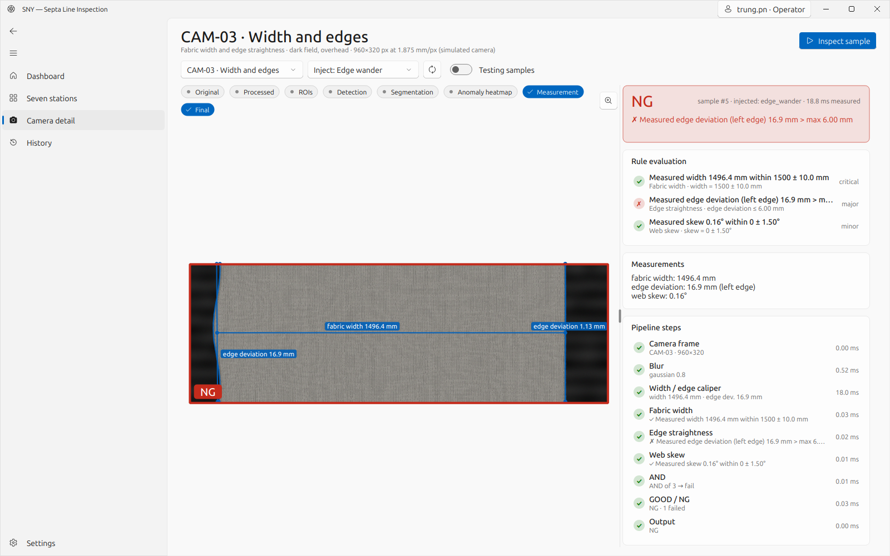 **Measurement.** Sub-pixel edge caliper: fabric width and edge deviation in mm. | 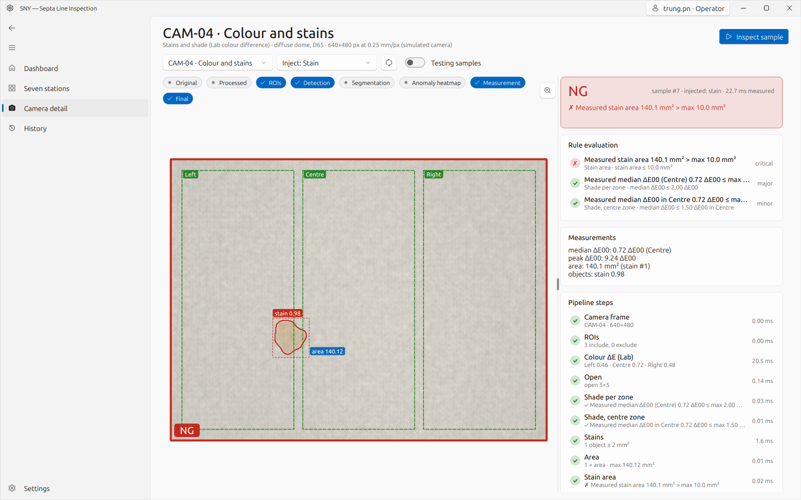 **NG result.** A stain found by CIEDE2000 against the product shade, with per-zone shade rules. |
| 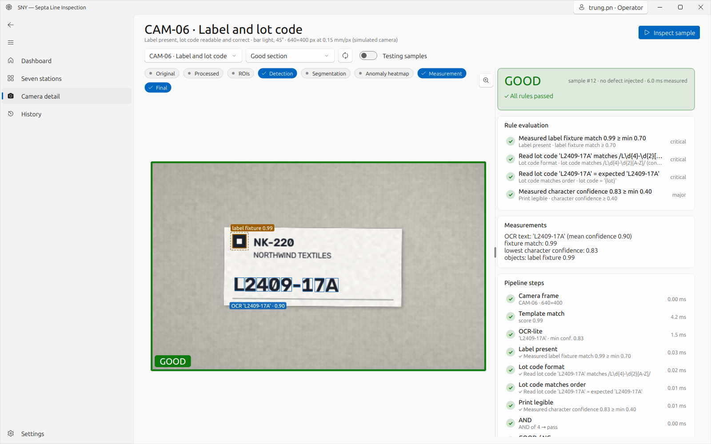 **GOOD result.** Label found by template matching; lot code read and checked against the order. | 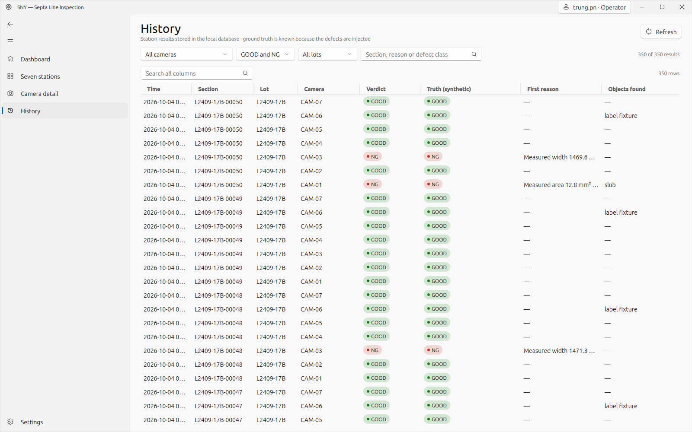 **History.** Every station result with verdict, injected ground truth and first reason. |
| 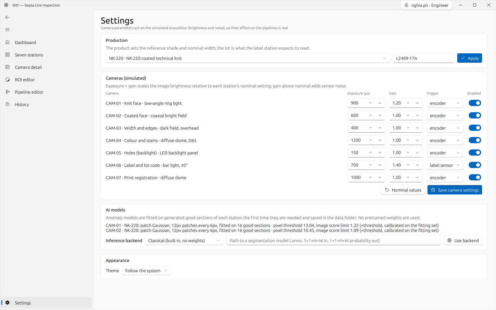 **Engineer settings.** Product and lot, simulated exposure / gain / trigger per camera, fitted models, inference backend. | 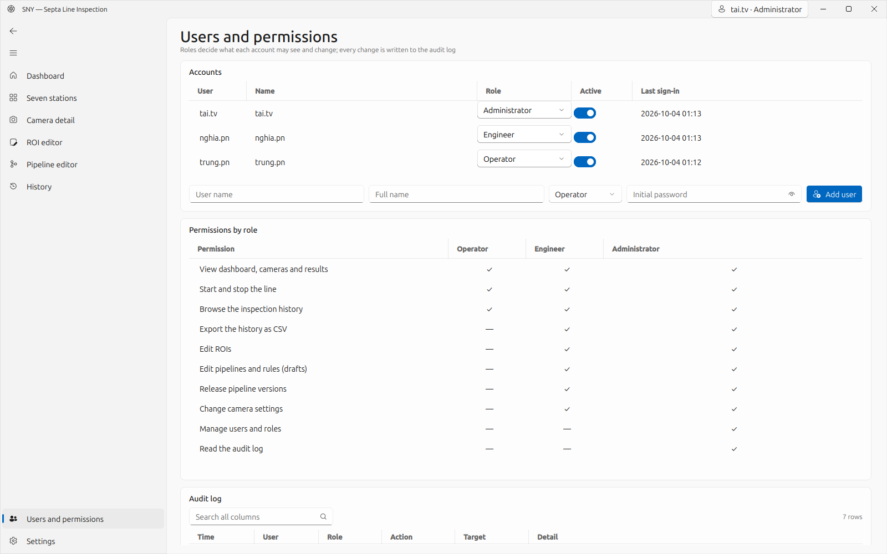 **Roles.** `trung.pn` operator, `nghia.pn` engineer, `tai.tv` administrator; permission matrix and audit log. |

<details>
<summary>Dark theme</summary>

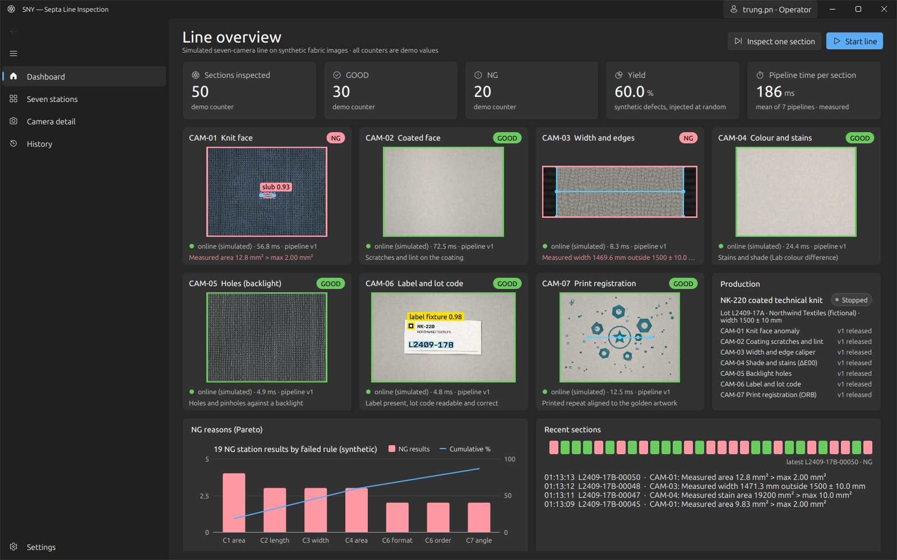

</details>

## Production Context

The portfolio implementation re-creates the ideas of a fabric-inspection system the author built and deployed in production. That original system, as stated on the author's CV:

- **7-camera fabric inspection** with overlapping camera coverage and defined inspection regions;
- **anomaly detection with MetaUAS, PatchCore and MemSeg** as interchangeable strategies, learned from good fabric; NG when the top-k anomaly-map score exceeds a threshold chosen by an F1 sweep;
- **about 93 % accuracy in real production**;
- vision connected directly to the line: **detection → ESP32 → machine stop, warning light and audible alarm**, so defects are caught early enough for operator intervention;
- **ESP32 motor monitoring and control**: speed measured and set through a VFD / inverter over **Modbus RTU**, telemetry published via **MQTT** to web monitoring.

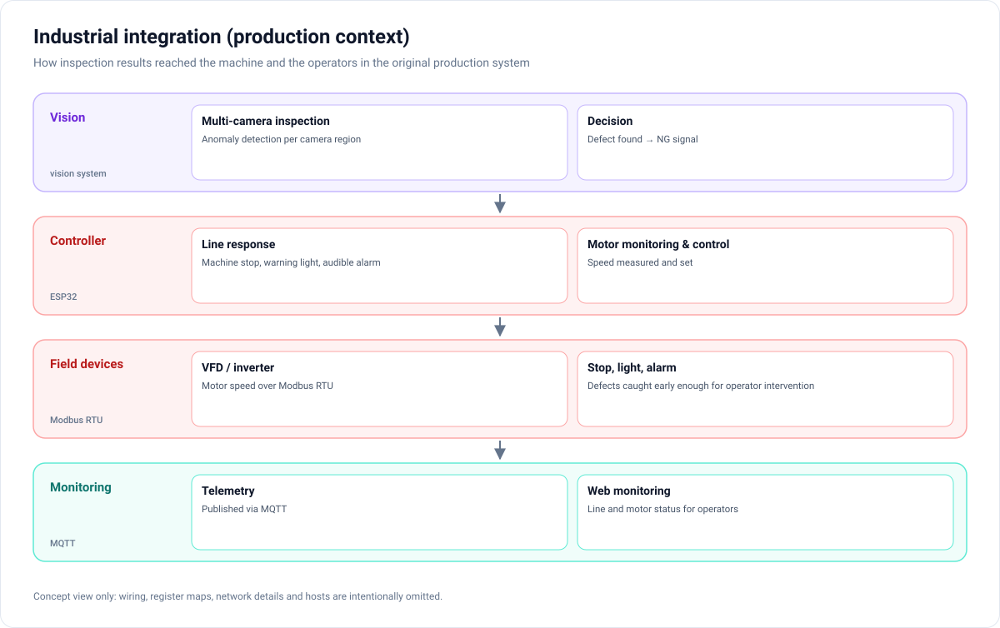

The production code, images, models and line configuration are not part of this repository. See [docs/production_context.md](docs/production_context.md).

## Engineering Focus

| Problem | Approach |
|---|---|
| Defects are rare and unlabelled | Learn "normal" from good fabric; flag deviations as an anomaly heatmap. |
| A heatmap is not a decision | Components → class → confidence → physical measurements → rules with limits and severities. |
| Different defects need different optics | One station per failure mode, each with its own lighting, calibration and pipeline. |
| Engineers must tune without breaking production | Draft / released pipeline versions, validation before release, parameter diffs, role-gated editing. |
| Operators must trust the reject | NG reasons as plain sentences, overlays on the image, step timings, history with replay. |
| Inspection must act on the line | (Production) NG drives an ESP32 that stops the machine and raises light and alarm; motor state is monitored over Modbus RTU and MQTT. |

## Demo / Portfolio Scope

- **Simulated line.** Fabric, lighting and defects are rendered procedurally from seeds; defects are injected with known ground truth. A few generated frames are in [`assets/demo/`](assets/demo/).
- **Real computation.** Every overlay, measurement and verdict on screen is computed by the pipelines at run time.
- **Weight-free AI.** The demo's anomaly model is a patch-statistics model fitted in seconds on generated good sections. It stands in for the deep anomaly models of the production system; no pretrained weights are used or published.
- **Demo numbers only.** Counters, yields and timings in the screenshots are demo values on synthetic data. The demo's test checks are about recovering the injected ground truth, not accuracy on a real line.
- **No hardware.** The portfolio implementation has no camera SDK, ESP32, Modbus or MQTT connection; those belong to the production context above.

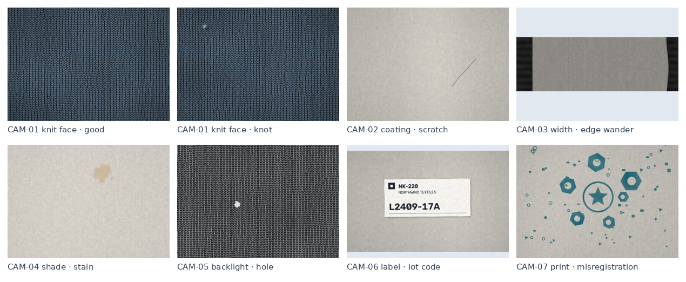

## Repository Scope

This repository contains documentation and portfolio-safe assets. Source code is intentionally not included.

```
README.md
docs/
  architecture.md          components, threading, data
  workflow.md              the seven station pipelines, rules and verdict
  technical_overview.md    anomaly model, measurement, rules, versioning
  production_context.md    the original system and its industrial integration
assets/
  screenshots/             captured from the running portfolio application
  diagrams/                architecture and pipeline diagrams (SVG)
  demo/                    synthetic frames generated by the simulator
```

## Disclaimer

All images, products, lots and company names shown (for example "NK-220" and "Northwind Textiles") are synthetic and fictional. The demo accounts `trung.pn`, `nghia.pn` and `tai.tv` are portfolio identities. Production figures are quoted from the author's CV and belong to the original system; they are not reproduced by, and cannot be verified with, the material in this repository. No confidential code, data, images or configuration from any employer or client is included.

© 2026 Phạm Ngọc Trung. Shared for portfolio review.
