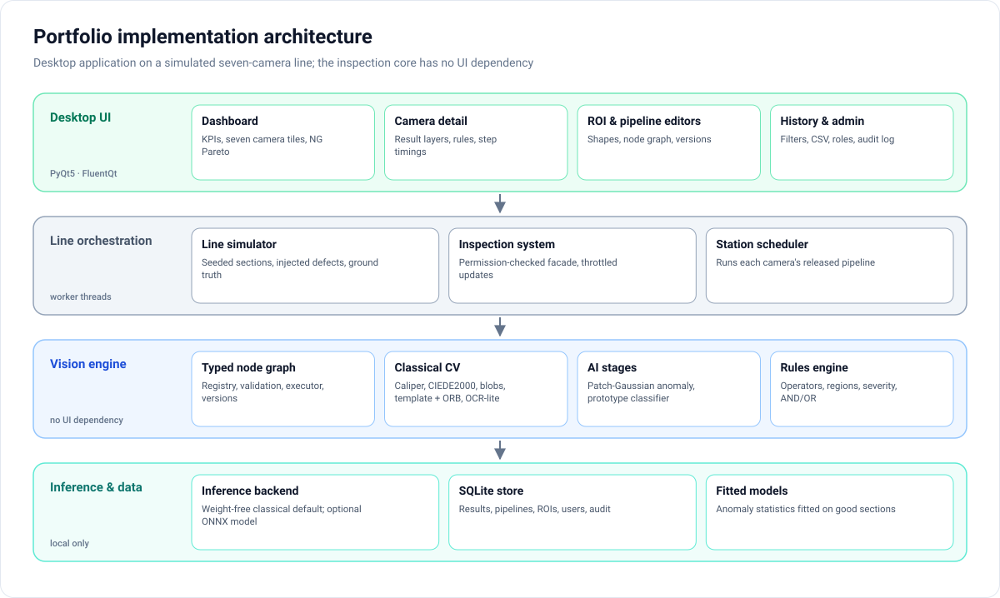
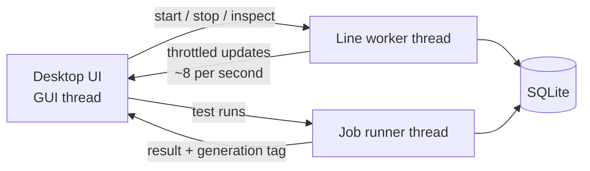

# Architecture

This page describes the **portfolio implementation** of SNY — Septa Line Inspection: a desktop application running a
simulated seven-camera line. For the original production system and its industrial integration, see
[production_context.md](production_context.md).

## Layers

| Layer | Responsibility |
|---|---|
| **Desktop UI** | Dashboard, seven-station view, camera detail with result layers, ROI editor, pipeline editor, history, settings, users and permissions. Built with PyQt5 and FluentQt, the author's Fluent-style component library. |
| **Line orchestration** | The line simulator produces fabric sections; a permission-checked inspection facade runs each camera's released pipeline and records the unit verdict. |
| **Vision engine** | A typed node graph (registry, validation, executor, versions), the classical CV operators, the AI stages and the rules engine. No UI dependency; tested headless. |
| **Inference & data** | A backend interface for segmentation and classification (weight-free classical default, optional ONNX model), the fitted anomaly statistics, and one local SQLite database. |

## The pipeline graph

Every station's logic is a graph of typed nodes: inputs (camera frame, image file, golden reference, ROIs),
preprocessing (crop, resize, normalise, colour convert, blur), vision (threshold, morphology, edges, contours,
connected components, template match, feature match, colour ΔE, caliper), AI (anomaly model, detection,
classification, confidence filter), measurements, rules, logic (AND / OR) and the GOOD / NG output.

- **Typed ports.** Images, masks, heatmaps, objects, measurements, regions and verdicts are distinct types; the
  editor dims incompatible ports.
- **Validation before release.** Type mismatches, cycles, unconnected required inputs, invalid parameters and a
  missing output are reported on the nodes themselves.
- **Executor.** Nodes run in topological order; each records its time, status, a one-line summary and its outputs,
  which the UI shows as per-node previews and as the step list on the camera page.
- **Versions.** Drafts are edited freely; releasing creates an immutable version with a parameter diff against the
  previous one. History stores which version produced each result.

## Threading and responsiveness

- Continuous inspection runs on a line worker; test runs from the editors run on a separate job runner.
- Updates to the UI are throttled, and each result carries a **generation**: results computed with a pipeline or ROI
  set that has since been replaced are dropped instead of displayed.
- Each thread uses its own database connection.

## Data

One SQLite database in the user's application-data folder holds users and roles, the audit log, settings, pipeline
versions, ROIs per camera, camera parameters and the inspection history (verdict, reasons, objects, measurements,
step durations, pipeline versions and the injected ground truth).

## Roles

| Role | Demo account | Can |
|---|---|---|
| Operator | `trung.pn` | View dashboard, cameras and results; start and stop the line; browse history |
| Engineer | `nghia.pn` | Everything an operator can, plus edit ROIs, edit and release pipelines, change camera settings, export CSV |
| Administrator | `tai.tv` | Everything, plus manage users and roles and read the audit log |
