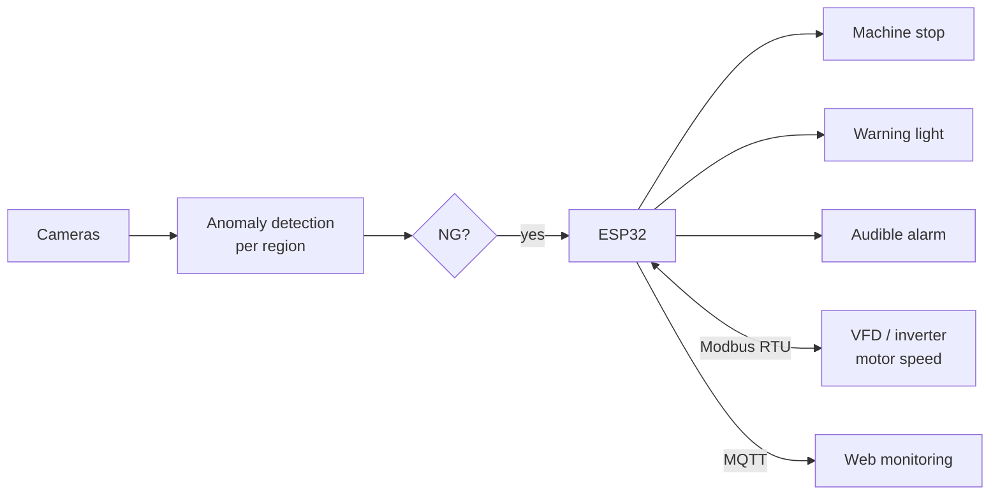

# Production Context

This page summarises the **original fabric-inspection system** the author built and deployed, which the portfolio
implementation is based on. The statements below are the ones on the author's CV. No production code, images, model
weights, line configuration or network details are published in this repository.

## What the production system did

| Area | Production system |
|---|---|
| Cameras | **Seven 4K Basler cameras** on two lines (five mesh types per line), with overlapping coverage and a defined inspection region per camera |
| AI | Unsupervised **anomaly detection** learned from good fabric, with **MetaUAS**, **PatchCore** and **MemSeg** as interchangeable strategies |
| Decision | NG when the top-k anomaly-map score exceeds a threshold, chosen by an F1 sweep |
| Result | **About 93 % accuracy in real production** |
| Line response | Detection → **ESP32** → **machine stop**, **warning light** and **audible alarm**, so defects are caught early enough for operator intervention |
| Motor | ESP32 motor monitoring and control: speed measured and set through a **VFD / inverter over Modbus RTU** |
| Monitoring | Telemetry published via **MQTT** to web monitoring |

## The three anomaly strategies

All three learn what *normal* fabric looks like rather than what each defect looks like, which suits a line where
defects are rare and varied:

- **PatchCore**: a memory bank of patch features from good images; distance to the nearest stored patch is the anomaly score.
- **MemSeg**: a segmentation network trained on good images with synthetically created anomalies and a memory of normal features.
- **MetaUAS**: compares an image with a good reference image to segment what differs.

## Industrial integration (concept)

Only the concept is shown: wiring, register maps, broker and host details are intentionally omitted.

## How the portfolio implementation relates

| | Production system | Portfolio implementation |
|---|---|---|
| Images | Real line captures (not published) | Procedurally generated fabric with injected defects |
| Anomaly model | MetaUAS / PatchCore / MemSeg | Weight-free patch-statistics model (PaDiM-style) |
| Cameras | 7 physical cameras | 7 simulated stations, each a different failure mode |
| Line output | ESP32 stop / light / alarm, Modbus RTU, MQTT | Not implemented; verdicts go to the history and dashboard |
| Accuracy | About 93 % in production | No accuracy claim; checks against injected ground truth only |

The portfolio implementation extends the concept with things that make the engineering visible: a visual pipeline
editor with versions, an ROI editor, a rules engine with readable reasons, history and role-based access.
