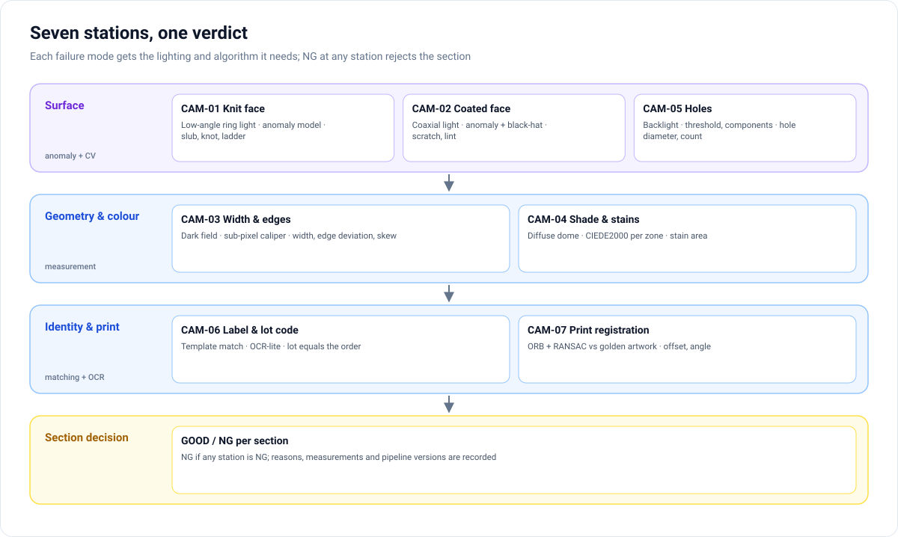
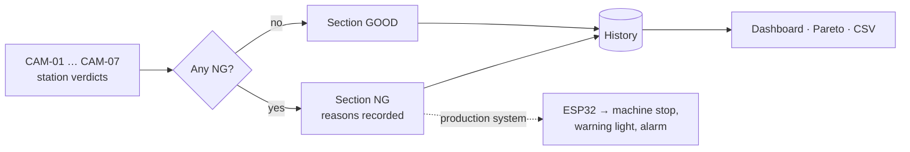

# Workflow

How one fabric section becomes a GOOD / NG decision in the **portfolio implementation**. The production system
followed the same camera → AI → decision → line-output pattern; see [production_context.md](production_context.md).

## 1. Acquisition (simulated)

The operator (`trung.pn` in the demo) starts the line or inspects a single section. For each section the simulator decides from a seed whether and where to inject defects, then renders the seven
camera views: knit loops under a low-angle ring light, a coating with sheen, the web on dark rollers, the coated face
under a diffuse dome, the knit against a backlight, a sewn label, and a printed repeat. Exposure and gain from the
settings scale brightness and add noise, so they genuinely affect the pipelines.

## 2. Per-station pipelines

Each camera runs its released pipeline version. The factory pipelines (all editable in the pipeline editor):

| Cam | Job | Pipeline | Rules (demo limits) |
|---|---|---|---|
| 01 | Knit face anomalies | ROI crop → patch-Gaussian anomaly → components → classification (slub / knot / ladder) → confidence filter → area, length | area ≤ 2 mm², length ≤ 6 mm, anomaly score ≤ 1.5 |
| 02 | Coating scratches, lint | ROI crop → anomaly → detection (scratch / lint) → length, area; in parallel gray → black-hat → threshold → open → components → size | length ≤ 3 mm, area ≤ 3 mm², dark-mark size ≤ 4 mm (minor) |
| 03 | Width and edges | blur → sub-pixel caliper per row, line fit per edge | width 1500 ± 10 mm (critical), edge deviation ≤ 6 mm, skew ± 1.5° (minor) |
| 04 | Shade and stains | CIEDE2000 to the product shade per ROI → stain mask → open → components → area | stain area ≤ 10 mm² (critical), median ΔE00 ≤ 2 per zone, ≤ 1.5 in the centre zone (minor) |
| 05 | Holes | ROI crop → gray → blur → threshold → open → components → diameter, count | no holes, diameter ≤ 0.5 mm |
| 06 | Label and lot code | template match of the fixture mark → OCR of the lot line relative to it | fixture found, lot format, lot equals the order, character confidence ≥ 0.4 |
| 07 | Print registration | ORB keypoints vs the golden artwork → ratio test → RANSAC similarity transform | offset ≤ 1 mm, angle 0 ± 0.5°, ≥ 8 matched features |

The AI station in detail:

## 3. Rules and the station verdict

Rule nodes evaluate measurements with operators (min, max, range, tolerance, count, text pattern), optional region
and confidence filters, an aggregation (worst object, sum, count) and a severity. AND / OR nodes combine them. The
GOOD / NG node turns failures below the reject severity into warnings, so a minor shade drift is reported without
stopping good fabric.

Each outcome is rendered as a sentence:

- *Measured area 3.83 mm² > max 2.00 mm²*
- *Measured width 1496.4 mm within 1500 ± 10.0 mm*
- *Read lot code 'L2409-17A' = expected 'L2409-17A'*

## 4. Section verdict and recording

The unit verdict is NG if any station is NG. The verdict, reasons, defects, measurements, step durations, pipeline
versions and the injected ground truth are written to the history. The dashboard updates its counters, NG Pareto
and recent-sections strip.

## 5. Engineering loop

1. `nghia.pn` (engineer) adjusts ROIs or a pipeline draft and runs it on generated samples with a chosen defect.
2. The editor validates the graph and shows per-node previews and timings.
3. The draft is released with a note; the parameter diff is stored.
4. `trung.pn` (operator) runs the line on the new version; history shows which version judged each section.
5. `tai.tv` (administrator) manages accounts and reviews the audit log.
